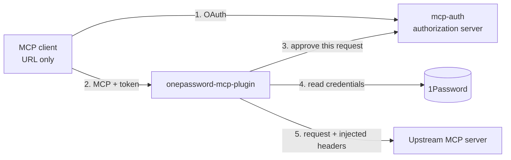

# onepassword-mcp-plugin

Stop pasting upstream credentials into MCP client configs.

Users keep their own credentials (a GitLab token, a Gerrit password, an Atlassian API token)
in 1Password. Their MCP client config holds **only the service URL**. This gateway sits in
front of the real MCP server, authenticates every request through
[mcp-auth](https://github.com/mcp-runtime/mcp-auth), fetches **that user's** credentials for
**that service**, and injects them into the request it forwards upstream.

* **Any upstream service** (GitLab, Gerrit, Atlassian, anything that takes credentials in headers) and **any login provider** that mcp-auth supports. The credential store is always 1Password.
* mcp-auth stays the only OAuth authorization server. This plugin is not one.
* Credentials are never returned to the MCP client.
* The 1Password SDK and service-account token live only in this plugin, never in mcp-auth.



Steps 2 to 5 run on every request (POST, GET/SSE, DELETE). Revoking a session or removing a
mapping takes effect on the next request.

## Before and after

```jsonc
// Before: credentials in every client's mcp.json
{ "url": "https://mcp.example.com/gitlab/mcp",
  "headers": { "X-GitLab-Username": "alice", "X-GitLab-PAT-Token": "glpat-..." } }

// After: URL only
{ "url": "https://mcp.example.com/gitlab/mcp" }
```

## Status

| Area | State |
| --- | --- |
| Gateway, per-request auth, injection, session binding, caching | Implemented, tested |
| End-to-end against the real mcp-auth server | Tested |
| GitLab mapping | Implemented, tested with fakes |
| Gerrit and Atlassian mappings | Config shapes only, not validated against those backends |
| **Live run with a real 1Password service account** | **Pending** ([canary](docs/canary.md)) |

Requires **mcp-auth v0.5.0 or later** (external credential connectors).

## Quick start

```bash
go test ./...                                        # unit and gateway tests, all fakes
MCP_AUTH_SRC=/path/to/mcp-auth go test ./e2e/        # against the real authorization server
docker build --build-arg VERSION=dev -t onepassword-mcp-plugin .
```

Run it with a config and mounted secrets: see [Deployment](docs/deployment.md) and
[`examples/`](examples/). Invalid configuration stops startup with a clear error.

## Docs

| | |
| --- | --- |
| [Architecture](docs/architecture.md) | Components, request flow, trust boundaries |
| [Configuration](docs/configuration.md) | Config keys, header transforms, caching, rotation, revocation |
| [Security](docs/security.md) | What is enforced and how |
| [Connect mcp-auth](docs/connect-mcp-auth.md) | The mcp-auth config and the values that must match |
| [Onboarding](docs/onboarding.md) | Where users store credentials, mappings, rotation, offboarding |
| [Client config](docs/client-config.md) | Before and after for MCP clients |
| [Backends](docs/backends.md) | GitLab, Gerrit, Atlassian, adding a service |
| [Deployment](docs/deployment.md) | Image, mounts, ingress, replicas, upgrades, local trial |
| [Live canary](docs/canary.md) | Checks to run with a real service account |
| [Wire contract](https://github.com/mcp-runtime/mcp-auth/blob/main/docs/external-credentials.md) | The token-exchange contract (in mcp-auth) |

## License

See [LICENSE](LICENSE).
