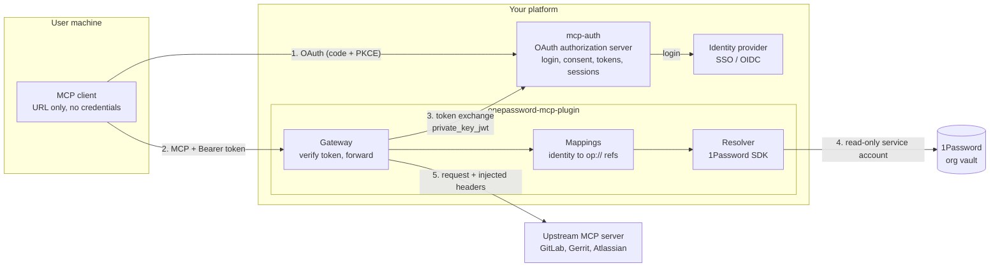
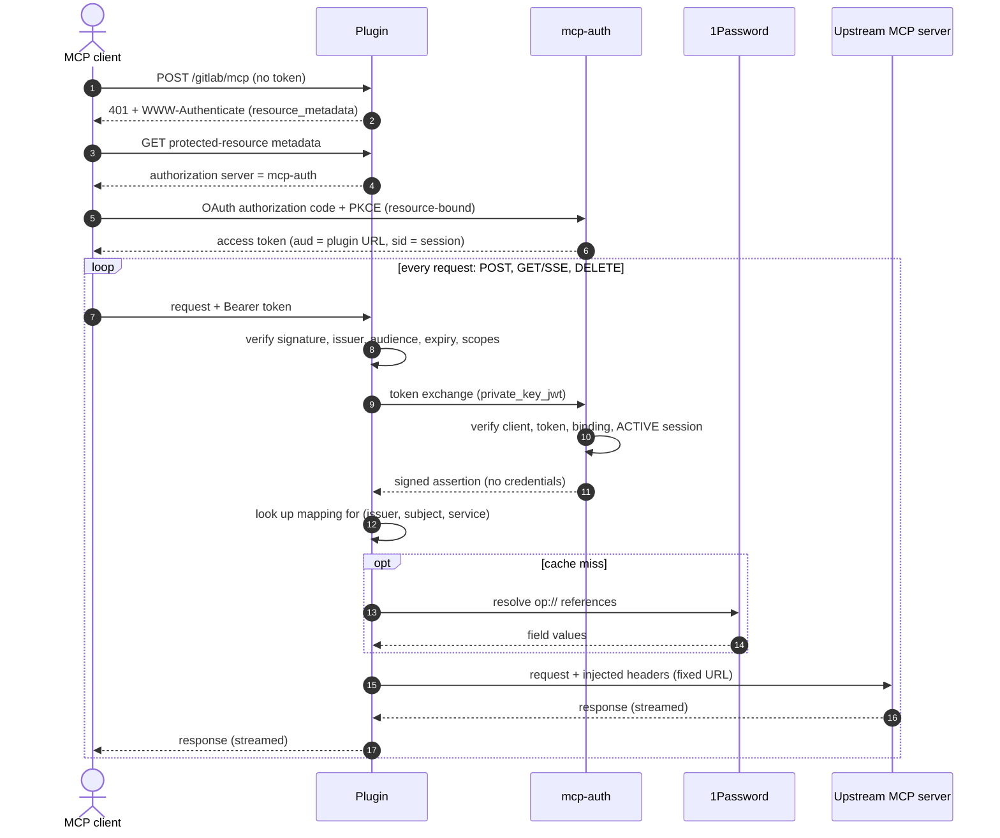

# Architecture

## Components

| Component | Owns |
| --- | --- |
| **MCP client** | Standard MCP OAuth. Holds only a short-lived token. Never sees upstream credentials. |
| **mcp-auth** | Login, consent, tokens, session validity and revocation, resource and scope policy, authenticating the plugin, minting the credential-access assertion. No secret-manager dependency. |
| **Plugin gateway** | Verifying the token on every request, requesting the assertion, header allowlisting, injection, streaming, session binding. |
| **Mappings** | Administrator-approved `(issuer, subject, service)` to `op://` references. |
| **Resolver** | The only code that imports the 1Password SDK and holds the service-account token. |
| **1Password** | Where users store their own credentials, in an organization or integration vault. |

The plugin is **not** an authorization server. A 1Password service account authenticates the
plugin to 1Password. It says nothing about who the human user is; that comes only from mcp-auth.

## Request flow

Every step after the token arrives runs on **every** request. A successful `initialize`
authorises nothing later. The exact exchange contract is in
[mcp-auth's wire contract](https://github.com/mcp-runtime/mcp-auth/blob/main/docs/external-credentials.md).

## Trust boundaries

* mcp-auth holds only the plugin's **public** key and connector settings. It has no 1Password
  SDK and no service-account token.
* The plugin holds the service-account token and the resource-client private keys, from mounted
  secret files. They are not in the image.
* Raw credentials exist only inside the plugin and on the connection to the upstream.

