# Connect mcp-auth to the plugin

The plugin and mcp-auth trust each other through one fixed handshake. You configure three
places: mcp-auth, the plugin, and 1Password. This page is the mcp-auth half and the values
that must match. It needs **mcp-auth v0.5.0 or later**.

```mermaid
flowchart LR
    subgraph mcpauth["mcp-auth config"]
        env["env: issuer, resources, scopes"]
        ext["external-credentials.json<br/>service + plugin public key"]
    end
    subgraph plug["plugin config"]
        cfg["config.json<br/>issuer, resource_url, client_id, private key"]
        map["mappings.json<br/>user to op:// refs"]
    end
    ext -. "same resource URL, scope, client id" .- cfg
    env -. "same issuer" .- cfg
    plug --> op[("1Password")]
```



Examples for everything below are in [`examples/mcp-auth/`](../examples/mcp-auth/).

## 1. Create the plugin's key pair

One pair per service. The plugin proves who it is to mcp-auth with the private key.

```bash
deploy/generate-resource-client.sh gitlab
# secrets/gitlab-plugin.pem      private, mounted into the plugin only
# secrets/gitlab-plugin.pub.pem  public, given to mcp-auth
```

## 2. Configure mcp-auth

**Environment** ([`mcp-auth.env.example`](../examples/mcp-auth/mcp-auth.env.example)):

| Variable | Value |
| --- | --- |
| `MCP_AUTH_ISSUER` | Public HTTPS URL of mcp-auth. |
| `MCP_AUTH_RESOURCES` | The plugin's public URL per service, exactly as MCP clients use it. |
| `MCP_AUTH_RESOURCE_SCOPES` | JSON map of that URL to its scopes, for example `{"https://mcp.example.com/mcp-proxy/gitlab/mcp":["gitlab:use"]}`. |
| `MCP_AUTH_EXTERNAL_CREDENTIALS_FILE` | Path to the file below. |
| `MCP_AUTH_REGISTRATION_ENABLED` | `true`, so MCP clients can register themselves. |
| `MCP_AUTH_STORE`, `MCP_AUTH_DATABASE_URL`, `MCP_AUTH_PRIVATE_KEY_FILE` | Durable store and signing key. Do not run production on the in-memory store or an ephemeral key. |

**1Password connector** ([`external-credentials.json`](../examples/mcp-auth/external-credentials.json)),
one entry per service:

```json
[
  {
    "id": "gitlab-1password",
    "resource": "https://mcp.example.com/mcp-proxy/gitlab/mcp",
    "required_scopes": ["gitlab:use"],
    "resource_client": {
      "client_id": "gitlab-1password-plugin",
      "public_key_file": "/etc/mcp-auth/gitlab-plugin.pub.pem",
      "algorithm": "RS256"
    },
    "assertion_ttl_seconds": 60
  }
]
```

mcp-auth holds only the plugin's **public** key. It never receives a 1Password token or any
credential. mcp-auth does not start if this file is invalid.

## 3. Configure the plugin

Production example: [`config.production.json`](../examples/config.production.json). Mount the
private key from step 1, the 1Password service-account token, and `mappings.json`.

## Values that must match

| What | mcp-auth | Plugin |
| --- | --- | --- |
| Issuer | `MCP_AUTH_ISSUER` | `authorization_server.issuer` (exact, including scheme and no trailing slash) |
| Service URL | `MCP_AUTH_RESOURCES`, `resource` | `services[].resource_url` |
| Scope | `MCP_AUTH_RESOURCE_SCOPES`, `required_scopes` | `services[].required_scopes` |
| Plugin identity | `resource_client.client_id` | `services[].resource_client.client_id` |
| Plugin key | `public_key_file` (public half) | `private_key_file` (private half) |
| Subject | the `sub` mcp-auth puts in the user's token | `subject` in `mappings.json` |
| Issuer in mappings | `MCP_AUTH_ISSUER` | `issuer` in `mappings.json` |

Two rules cause most failures:

* The plugin must reach mcp-auth at its **issuer URL**. It checks the token's `iss` against the
  issuer, and signs its login assertion for `<issuer>/token`. Do not point it at an internal
  hostname that differs from the issuer.
* The service URL is the token audience. If your ingress strips a path prefix, set the plugin's
  `public_path_prefix`, but keep `resource_url` as the full public URL.

## 4. Check it

1. Start mcp-auth. It fails at startup, with a message, if the connector file or scopes are wrong.
2. `curl https://auth.example.com/.well-known/oauth-protected-resource/mcp-proxy/gitlab/mcp`
   returns the resource and its `scopes_supported`.
3. Start the plugin. `GET /readyz` returns 200.
4. `curl -i -X POST https://mcp.example.com/mcp-proxy/gitlab/mcp` returns `401` with a
   `WWW-Authenticate` header whose `resource_metadata` points at the plugin.
5. Connect a real MCP client with the URL only, sign in, and call a tool.

## Troubleshooting

| Symptom | Likely cause |
| --- | --- |
| Plugin answers `503 authorization_unavailable`, mcp-auth logs a rejected client | `client_id` or key pair does not match what is in `external-credentials.json`. |
| `401 invalid_token` for every request | Issuer mismatch, wrong `resource_url` (audience), or the user signed in before the upgrade and has no session id. Sign in again. |
| `403 insufficient_scope` | The scope is missing from `MCP_AUTH_RESOURCE_SCOPES` or from the client's request. |
| `403 no_credential_mapping` | The user's subject or issuer in `mappings.json` does not match the token. |
| mcp-auth refuses to start | The external credentials file names a resource not in `MCP_AUTH_RESOURCES`, a scope not allowed for it, or a duplicate client. |
